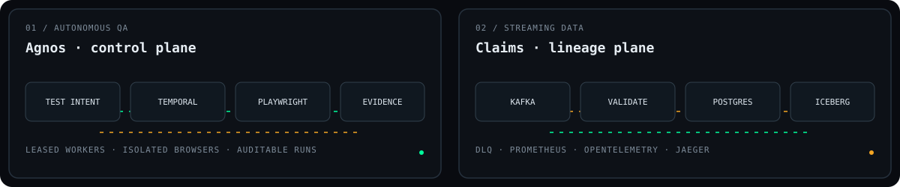

<div align="center">
  
</div>

<p align="center">
  <a href="https://tarunteju2.github.io/tarun-portfolio/">↗ PORTFOLIO</a>　·　
  <a href="https://www.linkedin.com/in/taruntarikere">↗ LINKEDIN</a>　·　
  <a href="mailto:tarunteju3@gmail.com">↗ EMAIL</a>　·　
  <a href="https://github.com/tarunteju2">↗ REPOSITORIES</a>
</p>

<p align="center"><code>JERSEY CITY, NJ</code>　<code>MS INFORMATION SYSTEMS · DATA MINING · NJIT · 3.75 GPA</code></p>

> I build self-healing data pipelines, autonomous AI control planes, and distributed systems that don't page you at 3 AM.

## 01 / Impact, measured

`ETL COST` **−40%**　·　`ANALYSIS TIME` **−88%**　·　`UPTIME` **99.99%**  
`PIPELINE P95` **< 5s**　·　`LOAN DOC THROUGHPUT` **+30%**

<sub>Glue partition pruning · 17h → 2h/week with dbt + AI agents · 10K+ records/day · 16 services / 7,700+ claims · 50K+ loans processed</sub>

## 02 / Systems in the field

<div align="center">
  
</div>

### `agn-1` / Agnos — autonomous QA control plane

**Private build · architecture overview** — five cooperating planes that take test intent through durable orchestration to isolated browser execution and auditable evidence. Source access is private.

`Node.js 22` · `Playwright` · `PostgreSQL 17` · `Temporal 1.25` · `React`  
`RLS` · `FOR UPDATE SKIP LOCKED` leases · HMAC-SHA256 webhooks · strict CSP · fail-closed audit logging  
**148 automated tests** · **7-job CI** with Trivy scanning and SBOM generation

### [`insurance-pipeline-observability`](https://github.com/tarunteju2/insurance-pipeline-observability) / Claims lineage

A real-time claims pipeline built to make delivery, failure, and recovery visible—from Kafka intake and validation to queryable storage and distributed traces.

`Python` · `Kafka` · `PostgreSQL` · `Airflow` · `Iceberg / MinIO` · `Docker Compose`  
**16 services** · **32 Prometheus metrics** · **22 alert rules** · **70 tests** (Pytest + Hypothesis)  
Circuit breakers · DLQ routing · PII masking · SHA-256 idempotency · OpenTelemetry · Grafana · Jaeger

## 03 / Engineering log

**`HEAD → main`　Wayfair** · AI Data Engineering Extern · `Jun 2026 — Present`  
dbt + Azure DevOps trend and competitor automation; 16+ PL/SQL reports with Prometheus monitoring; Redis-cached dashboards for AI-agent output.

**`8a4f2c`　Beats by Dre** · Quant & Qual Data Analyst · `Feb — Jun 2025`  
Kafka Streams sentiment pipeline (**60% faster insight delivery**) · automated data-quality checks (**70% less manual effort**) · demand forecast at **86% accuracy**.

**`3e9b1d`　Up Cancer** · Software Intern · `Jun — Nov 2024`  
AWS serverless ingestion at **99.99% uptime** · **1K+ req/min**, **<100ms p99** APIs · Terraform + GitHub Actions.

**`1c7d0a`　DIFACTO Robotics** · Robotics Intern · `Feb — Apr 2023`  
PySpark + Azure Data Factory IoT pipelines · C and AWS Lambda robotic-arm control loops.

## 04 / System stack

**DATA & STREAMING**　Kafka · Kafka Streams · Spark · PySpark · Flink · Airflow · dbt · Iceberg  
**CLOUD & INFRA**　AWS · Azure · Docker · Kubernetes · Terraform · CI/CD  
**STORAGE & QUERY**　PostgreSQL · Redis · Snowflake · MongoDB · Cassandra · Elasticsearch · Python · SQL · PL/SQL · C · Java · GraphQL  
**OBSERVABILITY & RELIABILITY**　Prometheus · Grafana · OpenTelemetry · Jaeger · FastAPI · circuit breakers · DLQs · idempotency

## 05 / GitHub telemetry

<details>
  <summary>Open contribution and language telemetry</summary>
  <br />
  <div align="center">
    
    
    
  </div>
</details>

```text
tarun@control-plane:~$ focus --now
> autonomous QA · observable data contracts · reliable AI workflows
```
