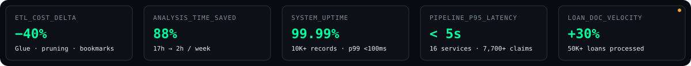

<div align="center">
  
</div>

<p align="center">
  <a href="https://www.linkedin.com/in/taruntarikere">--linkedin</a> ·
  <a href="https://github.com/tarunteju2/tarun-portfolio">--portfolio</a> ·
  <a href="mailto:tarunteju3@gmail.com">--email</a> ·
  <a href="https://github.com/tarunteju2">--resume</a>
</p>

<div align="center">
  
</div>

> **Operating thesis:** reliability is a feature. I build self-healing data pipelines, autonomous AI control planes, and distributed systems that don't page you at 3 AM.

<div align="center">
  
</div>

## `01 / active-deployments`

### `agn-1` · Agnos Autonomous QA Control Plane

**Five planes. One control loop.** A production-oriented QA platform that turns intent into isolated browser execution, evidence, and auditable outcomes.

```text
┌─ CONTROL PLANE ─────────────────────────────────────────────────────────────┐
│ React console → Node.js API → Temporal workflows → PostgreSQL lease queue   │
│                                      │                                       │
│                          sandboxed Chromium workers                         │
│                                      │                                       │
│                  artifacts · audit events · run intelligence                 │
└─────────────────────────────────────────────────────────────────────────────┘
```

`Node.js 22` · `Playwright` · `PostgreSQL 17` · `RLS` · `FOR UPDATE SKIP LOCKED` · `Temporal 1.25` · `React`

`[ HARDENED ]` HMAC-SHA256 webhooks · strict CSP · fail-closed audit logging · sandboxed workers  \
`[ VERIFIED ]` 148 automated tests · 7-job CI pipeline · Trivy scan · SBOM generation

→ [inspect the control plane](https://github.com/tarunteju2/agn-1)

### `insurance-pipeline-observability` · Claims Lineage Platform

**Telemetry as a first-class data product.** Real-time claims ingestion with lineage, quality gates, resilience patterns, and searchable operational evidence.

```text
Kafka → schema / PII gate → stream processors → PostgreSQL + Iceberg / MinIO
  │             │                    │                    │
  └────── DLQ ──┘             Airflow orchestration   Grafana / Jaeger
                              Prometheus · OTel · circuit breakers
```

`Python` · `Apache Kafka` · `PostgreSQL` · `Airflow` · `Apache Iceberg` · `MinIO` · `Docker Compose`

`[ OBSERVED ]` 32 Prometheus metrics · 22 alert rules · OpenTelemetry · Grafana · Jaeger  \
`[ RESILIENT ]` circuit breakers · DLQ routing · PII masking · SHA-256 idempotency · 70 tests (Pytest + Hypothesis)

→ [trace the claims pipeline](https://github.com/tarunteju2/insurance-pipeline-observability)

<div align="center">
  
</div>

## `02 / engineering-log`

```text
* HEAD -> main  Wayfair · AI Data Engineering Extern · Jun 2026—Present
│   ├─ dbt + Azure DevOps trend / competitor automation
│   ├─ 16+ automated PL/SQL + Prometheus reports
│   └─ Redis-cached dashboard for AI agent outputs
│
* 8a4f2c         Beats by Dre · Quant & Qual Data Analyst · Feb—Jun 2025
│   ├─ Python + Kafka Streams + AWS sentiment pipeline (-60% insight delivery time)
│   ├─ Docker / Airflow / Lambda data-quality validation (-70% manual effort)
│   └─ XGBoost / Random Forest demand forecasting (86% accuracy)
│
* 3e9b1d         Up Cancer · Software Intern · Jun—Nov 2024
│   ├─ Lambda + S3 + DynamoDB at 99.99% uptime
│   ├─ 1K+ requests/minute with <100ms p99 API latency
│   └─ Terraform + GitHub Actions CI/CD
│
* 1c7d0a         DIFACTO Robotics · Robotics Intern · Feb—Apr 2023
    ├─ PySpark + Azure Data Factory IoT sensor pipelines
    └─ C + AWS Lambda robotic-arm control loops
```

## `03 / system-stack`

| Plane | Runtime surface |
|---|---|
| **Data & Streaming** | Apache Kafka · Kafka Streams · Apache Spark · PySpark · Apache Flink · Airflow · dbt · Lakehouse / Apache Iceberg |
| **Cloud & Infrastructure** | AWS (Glue, Lambda, S3, DynamoDB, Redshift) · Azure (ADF, Event Hubs, Stream Analytics, DevOps) · Docker · Kubernetes · Terraform · CI/CD |
| **Storage & Query** | PostgreSQL · Redis · Snowflake · MongoDB · Cassandra · Elasticsearch · Python · SQL · PL/SQL · C · Java · GraphQL |
| **Observability & Reliability** | Prometheus · Grafana · OpenTelemetry · Jaeger · FastAPI · circuit breakers · DLQs · idempotency |

## `04 / github-telemetry`

<div align="center">
  
  
</div>

<div align="center">
  
</div>

```text
┌─ CURRENTLY HACKING ──────────────────────────────────────────────────────────┐
│ autonomous QA execution · observable data contracts · reliable AI workflows │
└─────────────────────────────────────────────────────────────────────────────┘

tarun@control-plane:~$ █
```
